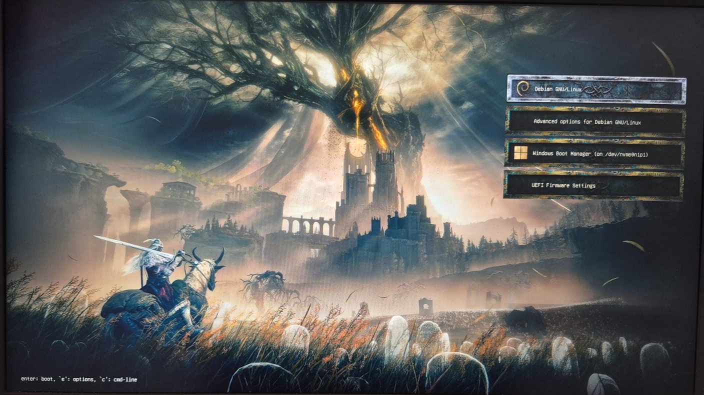

# EldGrub

EldGrub is a GRUB 2 theme inspired by the Lands Between from Elden Ring.

Designed for 16:9 displays.

- Recommended resolution: 1920×1080
- Supported resolution: 1366×768

## Installation

1. Copy the `EldGrub` directory to `/boot/grub/themes/`.

2. Edit `/etc/default/grub` and set:

   ```bash
   GRUB_THEME="/boot/grub/themes/EldGrub/theme.txt"
   ```

3. Regenerate the GRUB configuration:

   ```bash
   sudo grub-mkconfig -o /boot/grub/grub.cfg
   ```

4. Reboot to apply the theme.

## Preview (Not all Distros are here)



## Notes

Make sure all theme assets are present in their respective directories and that the GRUB configuration points to the correct theme path.
